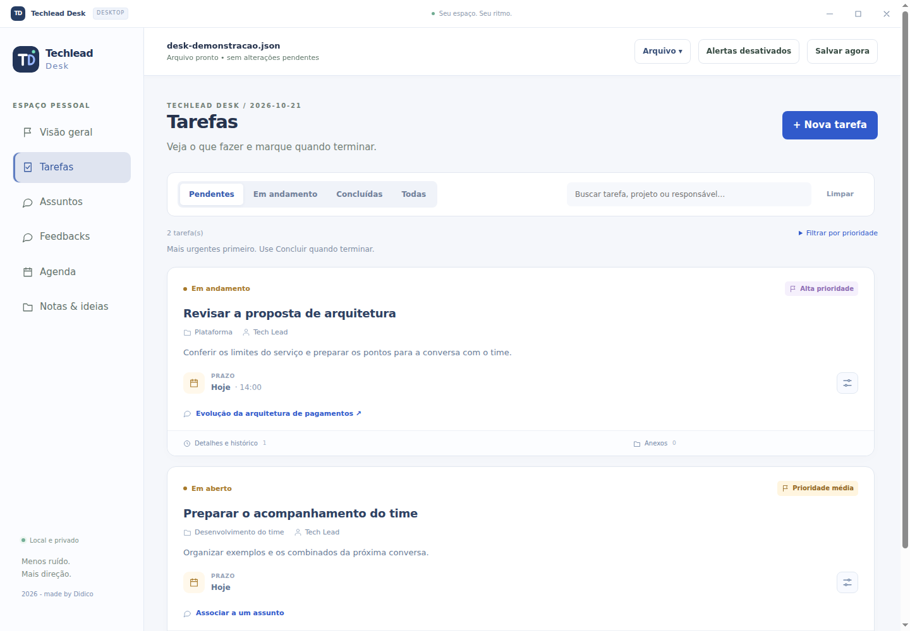
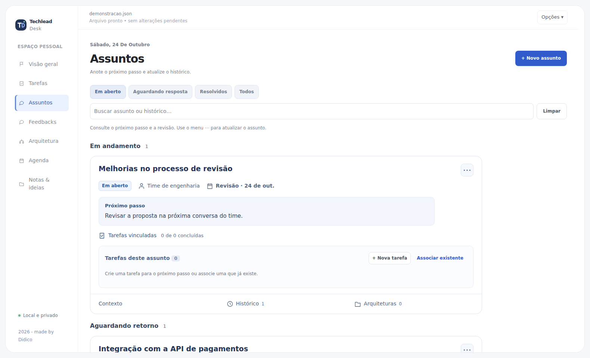
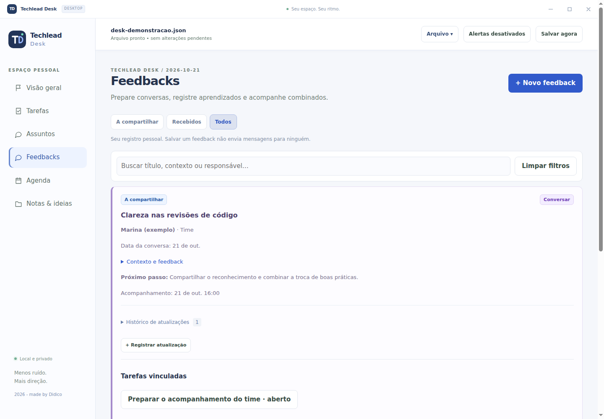
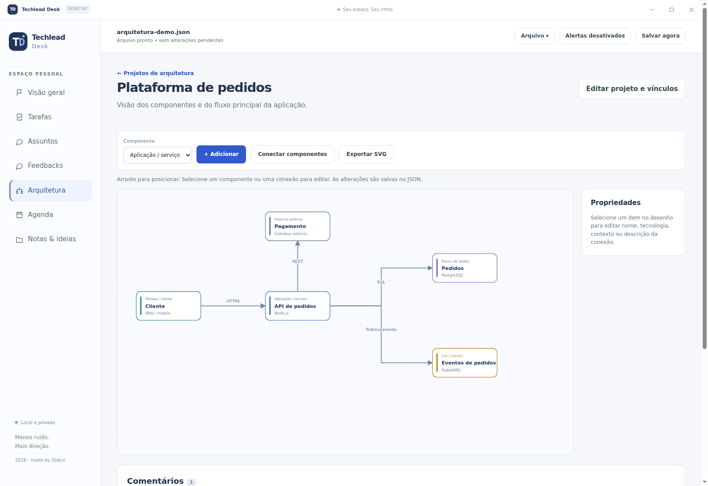
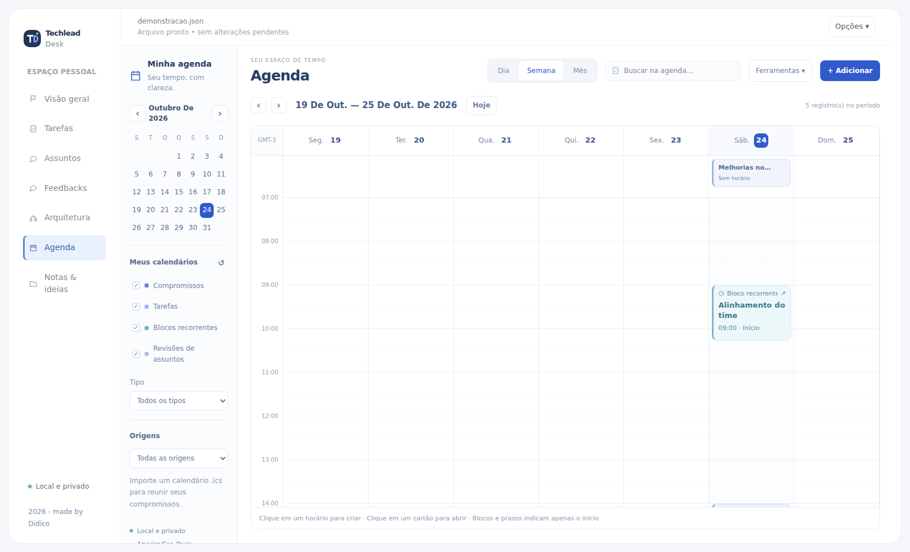
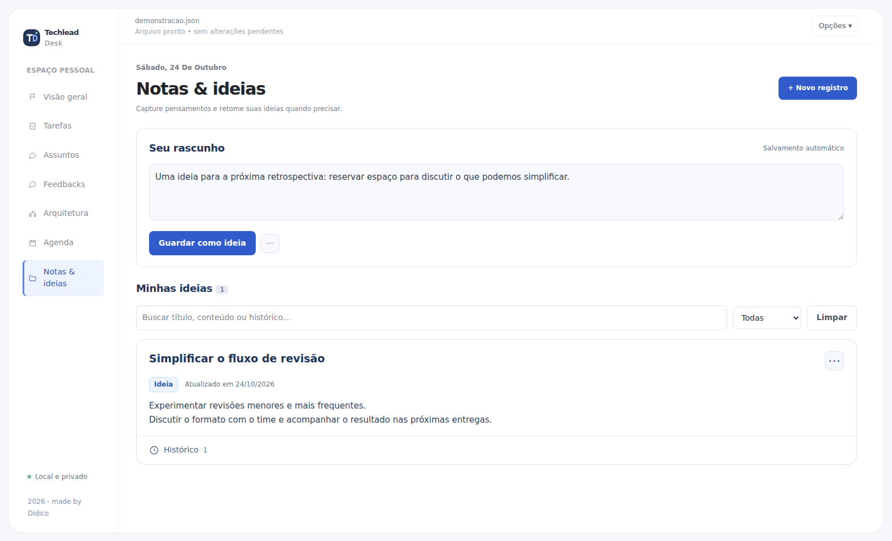
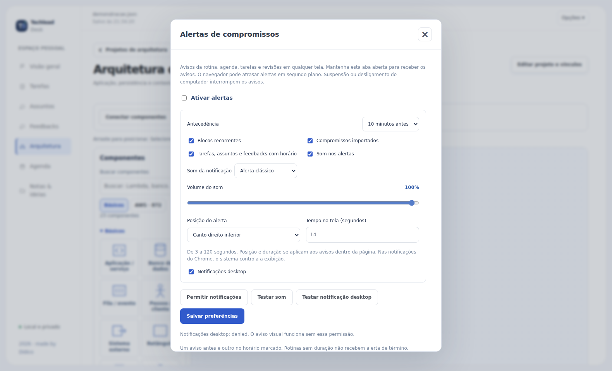

# Techlead Desk · Telas e funcionalidades

Um guia visual para conhecer o Desk e organizar tarefas, conversas, acompanhamentos e ideias. Os prints abaixo são do aplicativo em execução, com dados fictícios de demonstração. A versão web compartilha as mesmas telas; a barra de título e os controles de janela pertencem ao Electron.

[← Voltar ao README](README.md)

## Visão geral

O ponto de partida para entender o que merece atenção no dia.

- Indicadores de tarefas atrasadas, prazos de hoje, assuntos para revisar e respostas pendentes.
- Sugestões de tarefas organizadas por prazo e prioridade.
- Compromissos e horários do dia, com acesso direto à agenda.
- Resumo de tarefas abertas, prioridades altas e itens sem prazo.
- Atalhos para criar tarefas, registrar assuntos e capturar notas.

## Tarefas

Organize o trabalho com título, descrição, projeto, responsável, prioridade e prazo. A hora é opcional e permite receber alertas do compromisso.

- Consulte as listas **Pendentes**, **Em andamento**, **Concluídas** e **Todas**.
- Busque por tarefa, projeto ou responsável e filtre por prioridade.
- Use o menu de ações para iniciar, concluir, reabrir, editar, adicionar atualização ou excluir uma tarefa.
- Vincule uma tarefa a um assunto ou feedback para manter o contexto conectado.
- Guarde anexos no JSON e configure os limites por arquivo e por tarefa.
- Consulte o histórico das atualizações do registro.

As prioridades alta, média e baixa têm identificação visual própria. A exclusão exige confirmação.

## Assuntos

Acompanhe conversas, dúvidas e temas que precisam de continuidade, mesmo quando ainda não existe uma tarefa concreta.

- Registre o próximo passo, quem está cuidando e o contexto do assunto.
- Organize os registros entre **Em aberto**, **Aguardando resposta**, **Resolvidos** e **Todos**.
- Defina uma data e, se necessário, um horário para retomar o tema.
- Acrescente atualizações à linha do tempo e pesquise também no histórico.
- Crie tarefas a partir do assunto ou associe tarefas existentes.

Os vínculos permitem acompanhar o tema e suas ações no mesmo contexto. Excluir um assunto mantém as tarefas associadas, removendo o vínculo.

## Feedbacks

Prepare conversas e acompanhe os combinados, tanto dos feedbacks a compartilhar quanto dos recebidos.

- Alterne entre **A compartilhar**, **Recebidos** e **Todos**.
- Registre a pessoa, a relação ou papel e a data da conversa.
- Descreva a situação, o comportamento observado, o impacto e o próximo passo.
- Acompanhe as etapas **Preparar**, **Conversar**, **Refletir**, **Agir**, **Acompanhar** e **Encerrado**.
- Guarde atualizações no histórico e programe a data e hora de acompanhamento.
- Crie tarefas vinculadas aos próximos passos ou associe uma tarefa existente pelo editor da tarefa.

Os registros são pessoais: o Desk não envia o feedback para a pessoa. Excluir um feedback preserva as tarefas e remove apenas o vínculo.

## Arquitetura

Desenhe uma visão simples dos componentes e das integrações de uma aplicação, mantendo o contexto junto do trabalho do dia a dia.

- Crie vários projetos de arquitetura, cada um com nome, descrição e desenho próprios.
- Adicione aplicações/serviços, bancos de dados, filas/eventos, pessoas/clientes e sistemas externos.
- Arraste os componentes ou mova o componente selecionado com as setas do teclado.
- Edite o nome, o tipo, a tecnologia e o contexto de cada componente.
- Conecte origem e destino e descreva a comunicação, por exemplo **HTTPS**, **SQL** ou **publica evento**.
- Edite ou exclua componentes e conexões. Ao excluir um componente, suas conexões são removidas e os comentários são preservados no projeto.
- Registre, edite e exclua comentários sobre o projeto ou sobre um componente selecionado.
- Vincule cada projeto a um assunto e a uma tarefa. Os registros vinculados também oferecem acesso ao desenho.
- Exporte uma imagem **SVG** para compartilhar o diagrama. Para continuar editando, abra o JSON do Desk.
- Exclua projetos com confirmação, incluindo seus desenhos e comentários.

As alterações são gravadas automaticamente no mesmo JSON usado pelas versões web e Electron. O botão **Salvar agora** continua disponível. Não é necessário instalar outro editor de diagramas.

## Agenda

Veja os compromissos e os acompanhamentos em um calendário único.

- Navegue pelas visões de **dia**, **semana** e **mês** e volte rapidamente para hoje.
- Consulte prazos de tarefas, revisões de assuntos, acompanhamentos de feedbacks e blocos recorrentes.
- Crie blocos que se repetem semanalmente em um dia e horário definidos.
- Filtre os tipos de item e consulte os detalhes do dia selecionado.
- Importe calendários em formato **ICS**, identifique a origem e atualize o período importado.
- Confira indicações de sobreposição entre compromissos.

A importação ICS é somente leitura: não altera o calendário do Teams ou Outlook e não representa uma sincronização automática com esses serviços.

## Notas & ideias

Capture pensamentos rapidamente e transforme o que vale guardar em registros consultáveis.

- Escreva no rascunho, com gravação automática no arquivo aberto.
- Use **Guardar como ideia** para criar um registro com título e contexto.
- Crie uma tarefa a partir do rascunho ou transforme uma ideia em tarefa.
- Preserve o registro original quando uma tarefa for criada a partir dele.
- Acrescente atualizações com data e hora para manter o contexto ao longo do tempo.
- Pesquise no título, no contexto e nas atualizações dos registros.

## Alertas

Configure os avisos da rotina, da agenda e dos registros que têm data e hora.

- Ative os tipos de compromisso que deseja acompanhar.
- Escolha a antecedência: **5, 10, 15, 30 ou 60 minutos**.
- Selecione o toque e ajuste o volume do som.
- Escolha entre o centro da tela e os quatro cantos para a posição do aviso.
- Defina a duração de **3 a 120 segundos** e teste antes de salvar.
- Consulte os alertas disparados durante a sessão e abra o registro relacionado.

**No navegador**, posição e duração controlam os avisos dentro da página. As notificações do Chrome dependem de permissão e sua exibição é controlada pelo navegador e pelo sistema. A aba precisa permanecer aberta; avisos em segundo plano podem atrasar.

**No Electron**, os cartões próprios aparecem na área de trabalho e o Desk pode continuar ativo na bandeja. As preferências ficam no mesmo JSON usado pela versão web. Suspender o computador ou encerrar o aplicativo interrompe o monitoramento.

## Arquivo e uso diário

- Ao iniciar, **crie um JSON** ou **abra um arquivo existente**.
- Use **Arquivo → Trocar arquivo** para mudar de contexto e **Criar novo arquivo** para começar outro espaço.
- As alterações são gravadas automaticamente; **Salvar agora** permite solicitar uma gravação manual.
- No Electron, use **Arquivo → Sair do aplicativo** para encerrar por completo. Fechar a janela pode apenas ocultá-la na bandeja.
- O splash animado aparece na abertura. Os cabeçalhos dos modais permanecem fixos enquanto o conteúdo rola, e a navegação entre páginas volta ao topo.

Web e Electron usam o mesmo formato de dados. Abra o JSON explicitamente a cada sessão e evite editar o mesmo arquivo nos dois ambientes ao mesmo tempo.

[Como rodar e gerar os artefatos →](README.md)
